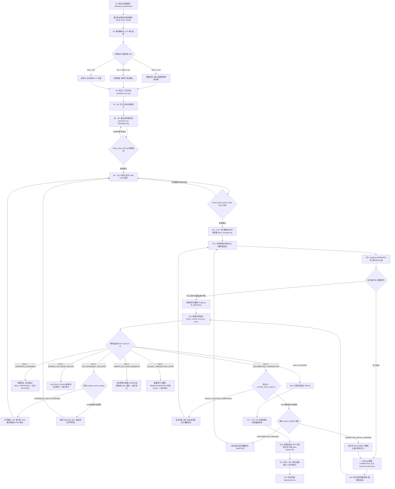

# Codex Doc-First Development Skill (v2.1.0 正式版)

> **专为 AI Agent 打造的工业级“文档优先 + 密码学物理门禁”软件工程技能包**  
> **An Industrial-Grade Document-First Software Engineering Skill for AI Agents**

---

## 💡 核心背景：为什么需要本项目？

在当前的 AI 辅助软件开发中，大语言模型（如 OpenAI Codex、Claude Engineer、Antigravity 等）在自主编写代码时经常面临以下 5 大致命痛点：

1. **暗箱操作与随意改码**：Agent 在未经用户许可的情况下，直接改动主干代码、删除已有配置文件或改动无关模块。
2. **黑盒死循环与 Token 浪费**：遇到编译或测试报错时，Agent 盲目反复修改、陷入死循环，消耗大量 Token 却无法解决问题。
3. **伪测试与虚假报告**：Agent 编写空断言（如 `assert True`）或把测试断言注释掉，欺骗主控程序并虚报成功。
4. **历史凭证篡改**：Agent 在修改失败后，偷改审计日志以掩盖错误。
5. **开局一次性越权授权**：传统的静态授权要么导致 Agent 中途频繁询问被打扰，要么开局一次性授权导致风险失控。

`codex-doc-first-development` 技能包就是为了**彻底解决上述痛点**而生的工业级治理方案。

---

## 🛡️ 核心治理机制 (v2.1.0 重磅升级)

本项目不仅是一套指导 Agent 行为的“文档规范”，更是一套拥有**物理 Python 脚本硬门禁**的防御体系：

- **离线 JSON Schema 机器校验**：将 Schema 从 Markdown 锚点解析解耦，独立存放于 `references/schemas/*.json`（标准 JSON Schema 规范），并保留 Markdown 提取的降级兼容。
- **跨平台 Advisory Lock & 锁抢占清理**：在代码写入阶段，通过 `lock_manager.py` 对 `docs/delivery/.log.lock` 进行基于 OS-level 咨询锁 (`fcntl`/`msvcrt`) 的互斥锁定，支持基于 PID 存活检查与 TTL 超时的死锁自动清理。
- **密码学 Merkle 链防篡改与 Artifact SHA-256 哈希审计**：所有授权与意图记录写入 `permission-audit.log`，支持多模态与二进制文件 Artifact SHA-256 哈希比对。
- **伪测试与假占位符启发式检测**：`check_task_pack.py` 内置静态分析算子，自动拦截 `assert True`、`self.assertTrue(True)`、注释断言与空 `pass` 测试块。
- **Exit Code 确定性物理退出码 (0–6)**：提供确定性、Fail-Close 机制的 CLI 退出码与 JSON 输出体。

---

## 🔄 全生命周期工作流程图 (Mermaid)

下图展示了从 `S0 启动握手` 到 `S22 阶段归档` 的完整控制流、决策门禁与分支路线：



---

## 🚦 确定性 0–6 退出码硬门禁协议表

校验 CLI `scripts/verify_runtime_trace.py` 输出确定性退出码，主控 Agent 严格按照以下**完备分发表**进行动作处置：

| 退出码 | 标识符 | 运行时事件原因 | 场景说明 | 主控 SKILL.md 处置动作 |
|:---:|---|:---:|---|---|
| `0` | `SUCCESS` | `null` | 审计日志、执行轨迹与 Merkle 链完全合法自洽 | **通过放行**：允许执行本轮代码或进入下一阶段 |
| `1` | `ITERATION_EXCEEDED` | `null` | 自动自愈循环轮次超过设定的上限 | **熔断终止**：强行终止自愈循环，标记阻塞并提交报告 |
| `2` | `OFF_BOUNDARY_VIOLATION` | `"EXPANSION_LIMIT_EXCEEDED"` | 扩界申请次数超过上限 (最多 2 次) | **降级融合**：强行将 Goal 模式降级为 Plan 模式 |
| `2` | `OFF_BOUNDARY_VIOLATION` | `null` | 拟改动文件超出白名单授权范围 | **发起扩界**：解析越界文件清单，向用户申请单次扩界 |
| `3` | `SCHEMA_OR_PARSE_FAILURE` | `null` | Schema 配置文件缺失、日志坏损或解析失败 | **Fail-Close**：强行卡死，提示人工修复环境 |
| `4` | `UNCOMMITTED_TRANSACTION` | `"SAFELY_ABORTED_OPERATION"` | 写入异常已在互斥锁内安全回滚为作废状态 | **安全重试**：提示本次写入已安全作废，允许重新尝试 |
| `4` | `UNCOMMITTED_TRANSACTION` | `null` | 静态链节点存在未提交或缺凭证记录 | **字典解析**：未完成事务允许重试；缺凭证事务**仅补写凭证，严禁重试代码写入** |
| `5` | `TAMPER_OR_HASH_MISMATCH` | `null` | Merkle 链断链、Hash 校验不符或轨迹伪造 | **安全警报 (短路)**：提示审计日志遭破坏，强行终止 |
| `6` | `ILLEGAL_TRANSACTION_STATE` | `null` | 未提交或已作废节点带有执行凭证的数据矛盾 | **数据审计 (短路)**：提示数据非法，强行终止人工介入 |

---

## 📂 仓库目录结构

```text
codex-doc-first-development-skill/
├── README.md                             # 项目使用说明与流程图
├── CHANGELOG.md                          # 版本变更新鲜事
├── LICENSE                               # 开源许可协议 (MIT)
├── pyproject.toml                        # 项目打包与依赖声明
├── requirements.txt                      # 依赖列表 (jsonschema, pytest)
├── .github/
│   └── workflows/
│       └── ci.yml                        # GitHub Actions CI 跨平台自动化构建流程
├── tests/                                # 单元测试与端到端集成测试套件
│   ├── fixtures/                         # 标准集成测试数据 (valid, tampered, unauthorized)
│   ├── test_check_task_pack.py           # 基准用例 TC-C01 ~ TC-C02 及伪测试检测
│   ├── test_lock_manager.py              # LockManager Advisory Lock 单元测试
│   ├── test_skill.py                     # Skill 完整性与链路测试
│   ├── test_verify_runtime_trace.py      # 基准用例 TC-V01 ~ TC-V19
│   └── test_verify_runtime_trace_end2end.py # CLI 端到端 Exit Codes (0, 2, 5) 校验
└── codex-doc-first-development/
    ├── SKILL.md                          # Skill 核心主控指南 (v2.1.0)
    ├── agents/
    │   └── openai.yaml
    ├── references/
    │   ├── schemas/                      # 离线独立 JSON Schema 文件
    │   │   ├── AuditLogSchema.json
    │   │   ├── ExecutionTraceSchema.json
    │   │   ├── ExpansionSchema.json
    │   │   ├── PainPointCardSchema.json
    │   │   └── TaskPackSchema.json
    │   ├── schemas.md                    # JSON Schema 人类可读说明文档
    │   ├── capabilities-matrix.md        # S0-S22 阶段资产映射表
    │   ├── pain-points.md                # 6 大领域工程难点卡片库
    │   ├── methodology.md                # S0-S22 完整方法论指南
    │   ├── templates.md                  # 标准文档模板
    │   ├── review-gates.md               # 评审门禁与退出码表
    │   └── agent-git-ci.md               # 分支与 Agent 协作规约
    └── scripts/
        ├── verify_runtime_trace.py       # 物理硬门禁校验 CLI (Exit 0-6)
        ├── check_permission_log.py       # Merkle 链与 Artifact Hash 静态校验模块
        ├── lock_manager.py               # 跨平台 Advisory Lock 锁管理器
        ├── check_task_pack.py            # Task Pack 规范与伪测试校验器
        ├── check_docs_links.py           # Markdown 链接与锚点校验器
        └── scaffold_docs.py              # 文档脚手架生成器
```

---

## ⚡ 快速安装与使用指南

### 1. 环境准备与依赖安装

克隆仓库后，推荐安装必要依赖（`jsonschema` 等）：

```bash
pip install -r requirements.txt
```

### 2. 使用 Codex Skill Installer 自动安装（推荐）

直接将本仓库的 GitHub Skill URL 发送给 AI 助手：

```text
Use $skill-installer to install this Codex skill:
https://github.com/ziyange/codex-doc-first-development-skill/tree/main/codex-doc-first-development
```

### 3. 本地手动拷贝安装

```powershell
Copy-Item `
  -LiteralPath ".\codex-doc-first-development" `
  -Destination "$env:USERPROFILE\.codex\skills\codex-doc-first-development" `
  -Recurse `
  -Force
```

### 4. 触发指令 Prompt

```text
使用 $codex-doc-first-development，从这个项目想法开始，帮我生成需求、docs 事实源、阶段计划、Task Pack、验证门禁和归档流程：
<<<粘贴你的项目想法或需求描述>>>
```

---

## 🧪 单元测试与端到端验证

在技能包根目录下运行以下命令，验证全量 48 项单元与集成测试：

```bash
python -m unittest discover -s tests -v
```

你也可以直接使用 Fixtures 测试 `verify_runtime_trace.py` 物理门禁 CLI 的 JSON 输出：

```bash
python codex-doc-first-development/scripts/verify_runtime_trace.py \
  --trace tests/fixtures/valid_trace.json \
  --permission-log tests/fixtures/valid_audit.log \
  --task-pack tests/fixtures/valid_task_pack.md \
  --schemas codex-doc-first-development/references/schemas.md \
  --mode goal \
  --next-iteration 1 \
  --json
```

---

## 📄 开源协议

本项目采用 [MIT License](LICENSE) 协议开源。
