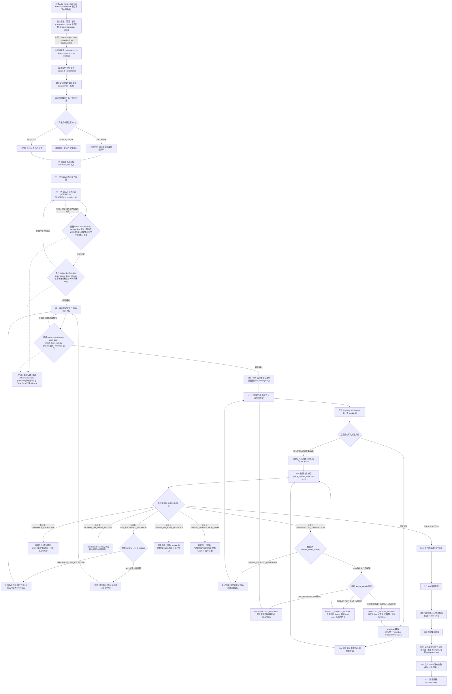

# Codex Doc-First Development Skill (v2.3.0 正式版)

> **专为 AI Agent 打造的工业级“文档优先 + 密码学物理门禁 + UI原型生图 + 功能独立化”软件工程技能包**  
> **An Industrial-Grade Document-First Software Engineering Skill for AI Agents**

---

## 💡 核心背景：为什么需要本项目？

在当前的 AI 辅助软件开发中，大语言模型（如 OpenAI Codex、Claude Engineer、Antigravity 等）在自主编写代码时经常面临以下 6 大致命痛点：

1. **文档设计与后续开发脱节**：前期设计了详尽的文档和接口，但进入编码后 Agent 凭感觉自由发挥，未按文档规格与接口契约专项开发。
2. **代码缺乏模块独立化与严重冗余**：同一个数据请求接口在 4 处业务组件中写了 4 遍，缺少统一的公共请求客户端/服务层与后端动态字段筛选（投影）机制。
3. **开发前缺少 UI/原型与接口绑定的用户对齐**：需求分析后直接编码，未提前与用户对齐各界面 UI 布局、原型图以及组件-接口调用映射表，未利用智能体生图能力生成直观界面预览。
4. **用户提修改建议后文档与代码不同步**：用户提出需求或修改建议后，Agent 仅修改代码而未同步更新 `docs/` 事实源，导致文档失真滞后。
5. **黑盒死循环与伪测试报告**：Agent 编写空断言（如 `assert True`）或注释掉测试断言以虚报测试通过。
6. **暗箱操作与随意越权改码**：Agent 在未经用户许可的情况下篡改未授权文件或主干配置。

`codex-doc-first-development` 技能包就是为了**彻底解决上述痛点**而生的工业级治理方案。

---

## 🛡️ 核心治理机制 (v2.3.0 总览)

本项目不仅是一套指导 Agent 行为的“文档规范”，更是一套拥有**物理 Python 脚本硬门禁**与**前置设计交互标准**的完整体系：

- **严格按文档专项开发（Spec-Driven Targeted Development）**：docs 为唯一事实源，Task Pack 中的接口签名、路由、数据结构与 UI 布局为硬性契约，主控验收门禁（S16）严格核验文档-代码一致性。
- **功能独立化与 DRY 模块复用架构**：复用公共请求模块，避免重复实现；字段投影和通用查询根据实际消费需求与性能要求引入，保持已有契约。
- **按变化适用的 UI/UX 门禁**：仅对图形界面的变化对齐布局、交互与状态，复用已确认设计；视觉决策未定时再生成原型。后端、CLI、脚本无图形界面变化时跳过视觉产物，本地界面无需虚构 API。
- **用户建议与变动同步联动机制**：任何来自用户修改建议或技术调整导致的架构、接口、UI/交互变动，必须同步更新项目目录文档（`docs/` 对应位置），代码变动严禁超前或背离文档。
- **离线 JSON Schema 机器校验**：将 Schema 独立存放于 `references/schemas/*.json`（标准 JSON Schema 规范，机器可读的权威源），并保留 Markdown 提取的降级兼容。
- **跨平台 Advisory Lock & 锁抢占清理**：在代码写入阶段，通过 `lock_manager.py` 对 `docs/delivery/.log.lock` 进行基于 OS-level 咨询锁 (`fcntl`/`msvcrt`) 的互斥锁定；持锁后方可校验并覆写过期/损坏的锁元数据，释放时只清空内容不删除锁文件，杜绝删锁竞态。
- **密码学 Merkle 链防篡改与可选 Artifact 元数据审计**：所有授权与意图记录写入 `permission-audit.log`；AuditLog/Trace Schema 支持可选的 `artifact_metadata`（`size_bytes` / `sha256` / `mime_type`）字段，供工件级审计扩展使用。
- **伪测试与假占位符启发式检测（warnings 通道）**：`check_task_pack.py`（位于 `codex-doc-first-task-pack-gate` 伴随技能）将 `assert True`、`self.assertTrue(True)`、注释断言与空 `pass` 测试块等命中收敛为非阻断 `warnings`（JSON 输出 `warnings` 数组，不改变退出码语义），占位符与结构性问题仍走阻断式 `issues`。
- **Exit Code 确定性物理退出码 (0–6)**：提供确定性、Fail-Close 机制的 CLI 退出码与 JSON 输出体。

---

## 🧩 技能套件组成 (Skill Suite)

v2.3.0 起，单体 Skill 按「调用双轴」拆分为 1 个主控 + 4 个可独立安装的伴随 Skill（规约见 [.agents/invocation.md](.agents/invocation.md)）：

| Skill | 调用轴 | 职责 |
|---|---|---|
| `codex-doc-first-development` | Model-invoked | 主控编排器：S0-S22 全生命周期、Exit 0-6 硬门禁、Merkle 链校验 |
| `codex-doc-first-start` | **User-invoked** | 人类入口：确认想法、范围与模式后交接主控（不可被模型自动触发） |
| `codex-doc-first-doc-sync` | Model-invoked | 双向文档同步纪律（S18/S20）+ `check_docs_links.py` 链接/锚点校验 |
| `codex-doc-first-task-pack-gate` | Model-invoked | Task Pack 就绪门禁（S9-S10）+ `check_task_pack.py` 校验 |
| `codex-doc-first-ui-ux-prototyping` | Model-invoked | 开发前 UI/UX 对齐门禁（S6）：原型、布局、组件-接口绑定矩阵、生图联动 |

主控 Skill 通过 `Call the Skill tool with "<name>"` 委托上述纪律步骤；伴随 Skill 未安装时，主控回退到 `references/review-gates.md` 内联清单并在 Task Pack 中记录 fallback。

---

## 🔄 全生命周期工作流程图 (Mermaid)

S0–S22 是生命周期索引，按任务适用阶段执行。Quick 复用已有任务/文档，缺少记录时只补目标、文件范围、验收和验证；Standard 维护受影响契约、Task Pack 与验证；Strict 保留完整适用文档和运行时审计。风险按影响判断，单文件权限或迁移变更仍属 Strict。已选择的 Goal/Plan/Build 审计协议不因 Quick 而省略输入，已有授权不重复询问。

下面展示完整生命周期与运行时审计路径；轻量任务不必遍历全部阶段。规则详见[任务适配策略](codex-doc-first-development/references/adaptive-workflow.md)，操作示例见[用户指南](docs/user-guide.md)。



---

## 🚦 确定性 0–6 退出码硬门禁协议表

校验 CLI `codex-doc-first-development/scripts/verify_runtime_trace.py` 输出确定性退出码，主控 Agent 严格按照以下**完备分发表**进行动作处置：

| 退出码 | 标识符 | 运行时事件原因 | 场景说明 | 主控 SKILL.md 处置动作 |
|:---:|---|:---:|---|---|
| `0` | `SUCCESS` | `null` | 审计日志、执行轨迹与 Merkle 链完全合法自洽 | **通过放行**：允许执行本轮代码或进入下一阶段 |
| `1` | `ITERATION_EXCEEDED` | `null` | 自动自愈循环轮次超过设定的上限 | **熔断终止**：强行终止自愈循环，标记阻塞并提交报告 |
| `2` | `OFF_BOUNDARY_VIOLATION` | `"EXPANSION_LIMIT_EXCEEDED"` | 扩界申请次数超过上限 (最多 2 次) | **降级融合**：强行将 Goal 模式降级为 Plan 模式 |
| `2` | `OFF_BOUNDARY_VIOLATION` | `null` | 拟改动文件超出白名单授权范围 | **发起扩界**：解析越界文件清单，向用户申请单次扩界 |
| `3` | `SCHEMA_OR_PARSE_FAILURE` | `null` | Schema 配置文件缺失、日志坏损或解析失败 | **Fail-Close**：强行卡死，提示人工修复环境 |
| `4` | `UNCOMMITTED_TRANSACTION` | `"SAFELY_ABORTED_OPERATION"` | 写入异常已在互斥锁内安全回滚为作废状态 | **安全重试**：提示本次写入已安全作废，允许重新尝试 |
| `4` | `UNCOMMITTED_TRANSACTION` | `null` | 未提交事务（`reason_details` = `UNCOMMITTED_PENDING`）：AuditLog 已记录意图但未翻转 COMMITTED | **重试或作废**：提示重试该动作，或翻转为 ABORTED |
| `4` | `UNCOMMITTED_TRANSACTION` | `null` | 已提交但缺凭证（`reason_details` = `COMMITTED_RESULT_MISSING`）：事务 COMMITTED 却无 Result trace | **仅补凭证**：严格禁止重试代码写入，只补写 Result trace |
| `4` | `UNCOMMITTED_TRANSACTION` | `null` | 孤儿轨迹（`reason_details` = `RESULT_WITHOUT_INTENT`）：存在 Result trace 但 AuditLog 无对应 intent | **丢弃并回填**：删除孤儿 Result，核对 audit intent 后重跑 `verify_runtime_trace.py` |
| `5` | `TAMPER_OR_HASH_MISMATCH` | `null` | Merkle 链断链、Hash 校验不符或轨迹伪造 | **安全警报 (短路)**：提示审计日志遭破坏，强行终止 |
| `6` | `ILLEGAL_TRANSACTION_STATE` | `null` | 未提交或已作废节点带有执行凭证的数据矛盾 | **数据审计 (短路)**：提示数据非法，强行终止人工介入 |

---

## 📂 仓库目录结构

```text
codex-doc-first-development-skill/
├── README.md                             # 项目使用说明与流程图（中文）
├── CHANGELOG.md                          # 版本变更记录（Keep a Changelog / SemVer，仓库根目录）
├── LICENSE                               # 开源许可协议 (MIT)
├── AGENTS.md                             # 仓库地图、命令、双语政策、Skill 创作与版本规约
├── CLAUDE.md                             # 指向 AGENTS.md 的符号链接
├── SCOPE.md                              # 贡献门槛（真实失败 + 契合理念）
├── GLOSSARY.md                           # 全仓库共享术语表与已裁决歧义
├── pyproject.toml                        # 项目元数据、版本号与 ruff 配置
├── requirements.txt                      # 依赖列表 (jsonschema)
├── .agents/
│   └── invocation.md                     # 技能调用双轴（user-invoked / model-invoked）与跨技能引用语法
├── .changeset/
│   └── config.json                       # changesets 版本管理配置
├── .out-of-scope/
│   └── README.md                         # 已拒绝概念的归档约定
├── .github/
│   └── workflows/
│       ├── ci.yml                        # CI：3 OS × Python 3.9/3.12 测试 + ruff + docs 自检
│       └── release.yml                   # changesets 版本 PR + tag 触发的 GitHub Release
├── docs/
│   └── user-guide.md                     # 中文用户手册
├── tests/                                # 单元与端到端集成测试套件（76 项）
│   ├── fixtures/                         # 标准集成测试数据 (valid, tampered, unauthorized)
│   ├── test_check_task_pack.py           # Task Pack 校验与 warnings 通道用例
│   ├── test_doc_sync.py                  # GFM 锚点语义与链接检查端到端用例
│   ├── test_lock_manager.py              # LockManager Advisory Lock 单元测试
│   ├── test_pain_points.py               # 6 张难点卡片有效性校验
│   ├── test_schemas_parity.py            # schemas.md 与独立 JSON 双源一致性
│   ├── test_skill.py                     # 多 Skill 完整性与链路测试
│   ├── test_verify_runtime_trace.py      # 基准用例 TC-V01 ~ TC-V24
│   └── test_verify_runtime_trace_end2end.py # CLI 端到端 Exit Codes (0, 2, 5) 校验
├── codex-doc-first-development/          # 主控 Skill（编排 S0-S22 全生命周期）
│   ├── SKILL.md                          # Skill 核心主控指南 (v2.3.0)
│   ├── agents/
│   │   └── openai.yaml
│   ├── references/
│   │   ├── schemas/                      # 离线独立 JSON Schema 文件（机器可读权威源）
│   │   │   ├── AuditLogSchema.json
│   │   │   ├── ExecutionTraceSchema.json
│   │   │   ├── ExpansionSchema.json
│   │   │   ├── PainPointCardSchema.json
│   │   │   └── TaskPackSchema.json
│   │   ├── schemas.md                    # JSON Schema 人类可读说明文档（Markdown 降级源）
│   │   ├── capabilities-matrix.md        # S0-S22 阶段资产映射表
│   │   ├── pain-points.md                # 6 大领域工程难点卡片库
│   │   ├── methodology.md                # S0-S22 完整方法论指南
│   │   ├── templates.md                  # 标准文档模板
│   │   ├── review-gates.md               # 评审门禁与退出码表
│   │   ├── prompts.md                    # 可复用提示词模板
│   │   ├── examples.md                   # 场景示例
│   │   └── agent-git-ci.md               # 分支与 Agent 协作规约
│   └── scripts/
│       ├── verify_runtime_trace.py       # 物理硬门禁校验 CLI (Exit 0-6)
│       ├── check_permission_log.py       # Merkle 链静态校验模块（被 verify_runtime_trace 引用）
│       ├── lock_manager.py               # 跨平台 Advisory Lock 锁管理器
│       └── scaffold_docs.py              # 文档脚手架生成器
├── codex-doc-first-doc-sync/             # 伴随 Skill：文档同步纪律 + 链接校验
│   ├── SKILL.md
│   ├── agents/openai.yaml
│   ├── references/doc-sync-checklist.md
│   └── scripts/check_docs_links.py       # Markdown 链接与锚点校验器（GFM 严格 slug）
├── codex-doc-first-task-pack-gate/       # 伴随 Skill：Task Pack 就绪门禁
│   ├── SKILL.md
│   ├── agents/openai.yaml
│   ├── references/task-pack-gate.md
│   └── scripts/check_task_pack.py        # Task Pack 规范校验器（issues 阻断 + warnings 提示）
├── codex-doc-first-ui-ux-prototyping/    # 伴随 Skill：开发前 UI/UX 对齐门禁（纯纪律）
│   ├── SKILL.md
│   ├── agents/openai.yaml
│   └── references/ux-alignment-gate.md
└── codex-doc-first-start/                # 伴随 Skill：人类入口（user-invoked）
    ├── SKILL.md                          # frontmatter 含 disable-model-invocation: true
    └── agents/openai.yaml                # 含 policy.allow_implicit_invocation: false
```

---

## 📜 仓库规约 (Repository Conventions)

本仓库遵循一套显式的工程规约（英文文档，与 mattpocock/skills 等成熟 Skill 仓库的实践对齐）：

- **[AGENTS.md](AGENTS.md)**（`CLAUDE.md` 为其符号链接）：仓库地图、命令、双语政策（Skill 内部英文 / README 与手册中文）、Skill 创作规约、版本管理方式。
- **[SCOPE.md](SCOPE.md)**：贡献门槛——必须同时满足「真实观察到的失败」与「契合理念（docs 唯一事实源 / Fail-Close / 可验证证据）」。
- **[GLOSSARY.md](GLOSSARY.md)**：全仓库共享术语表，含 Avoid 提示与已裁决的歧义记录（如三重 "mode" 重载）。
- **[.agents/invocation.md](.agents/invocation.md)**：技能调用双轴模型——User-invoked（仅人类 `/命令` 触发，编排层）与 Model-invoked（模型可自动触达，承载可复用纪律）；跨技能引用统一为 "Call the Skill tool with '<name>'"。
- **[.out-of-scope/](.out-of-scope/README.md)**：已拒绝概念的归档及理由。
- **[.changeset/](.changeset/config.json) + [CHANGELOG.md](CHANGELOG.md)**：基于 changesets 的版本管理（Keep a Changelog / SemVer），CHANGELOG 位于仓库根目录。
- **[发布维护](docs/releasing.md)**：保留 changeset 格式，由 Python 生成版本变更并创建 Version Skills PR，无需 `package.json`；版本分支单独运行 CI，合并和 tag 发布保持显式操作。

---

## ⚡ 快速安装与使用指南

### 1. 环境准备与依赖安装

克隆仓库后，推荐安装必要依赖（`jsonschema` 等）：

```bash
pip install -r requirements.txt
```

### 2. 使用 Codex Skill Installer 自动安装（推荐）

直接将本仓库的 GitHub Skill URL 发送给 AI 助手：

```text
Use $skill-installer to install this Codex skill:
https://github.com/ziyange/codex-doc-first-development-skill/tree/main/codex-doc-first-development
```

可选：如需启用"纪律委托"而非内联回退，逐个安装伴随技能（一次发送一条 URL）：

```text
https://github.com/ziyange/codex-doc-first-development-skill/tree/main/codex-doc-first-doc-sync
https://github.com/ziyange/codex-doc-first-development-skill/tree/main/codex-doc-first-task-pack-gate
https://github.com/ziyange/codex-doc-first-development-skill/tree/main/codex-doc-first-ui-ux-prototyping
https://github.com/ziyange/codex-doc-first-development-skill/tree/main/codex-doc-first-start
```

> `codex-doc-first-start` 是 **user-invoked** 人类入口（`disable-model-invocation: true`），安装后只能由你手动输入 `/codex-doc-first-start` 触发，模型不会自动调用它。

### 3. 本地手动拷贝安装

```powershell
Copy-Item `
  -LiteralPath ".\codex-doc-first-development" `
  -Destination "$env:USERPROFILE\.codex\skills\codex-doc-first-development" `
  -Recurse `
  -Force
```

> **伴随 Skill（可选增量）**：`codex-doc-first-doc-sync`、`codex-doc-first-task-pack-gate`、`codex-doc-first-ui-ux-prototyping`、`codex-doc-first-start` 可按需同样拷贝安装。5 个目录彼此独立，逐目录拷贝即可（`codex-doc-first-start` 没有 references/ 目录）。主控 Skill 单独安装即可完整工作（自动回退到内联清单）；安装伴随 Skill 后，主控会把对应纪律步骤委托给它们。

### 4. 触发指令 Prompt

```text
使用 $codex-doc-first-development，从这个项目想法开始，帮我生成需求、docs 事实源、阶段计划、Task Pack、验证门禁和归档流程：
<<<粘贴你的项目想法或需求描述>>>
```

---

## 🧪 单元测试与端到端验证

在技能包根目录下运行以下命令，验证全量单元与集成测试：

```bash
python -m unittest discover -s tests -v
```

你也可以直接使用 Fixtures 测试 `verify_runtime_trace.py` 物理门禁 CLI 的 JSON 输出：

```bash
python codex-doc-first-development/scripts/verify_runtime_trace.py \
  --trace tests/fixtures/valid_trace.json \
  --permission-log tests/fixtures/valid_audit.log \
  --task-pack tests/fixtures/valid_task_pack.md \
  --schemas codex-doc-first-development/references/schemas.md \
  --mode goal \
  --next-iteration 1 \
  --json
```

---

## 📄 开源协议

本项目采用 [MIT License](LICENSE) 协议开源。
